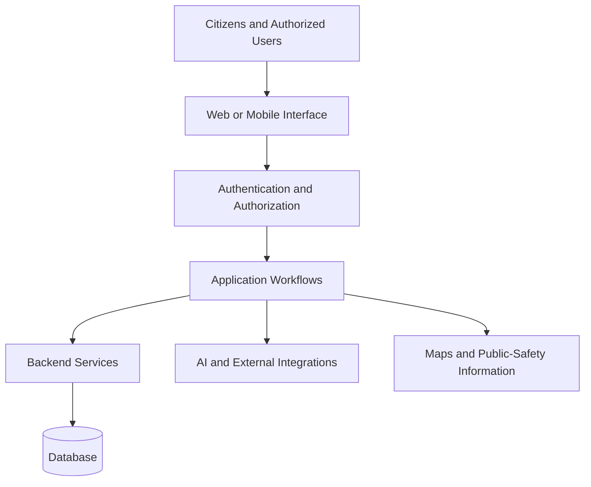

# NYAYA-MITRA — AI-Assisted Police Governance & Citizen Engagement Platform

**A Full-Stack Project Exploring Digital Citizen Services, Police Workflows, Public Safety, and AI-Assisted Guidance**

[](https://github.com/NageswarBellamkonda/FINAL-YEAR-PDD-PROJECT)
[](https://react.dev/)
[](https://vite.dev/)
[](https://www.postgresql.org/)
[](https://supabase.com/)

**Repository:** [NYAYA-MITRA on GitHub](https://github.com/NageswarBellamkonda/FINAL-YEAR-PDD-PROJECT)

**Web Demo:** [Open the NYAYA-MITRA Web Application](https://nageswarbellamkonda.github.io/FINAL-YEAR-PDD-PROJECT/)

---

## Table of Contents

- [Overview](#overview)
- [Problem Statement](#problem-statement)
- [Project Objectives](#project-objectives)
- [Key Features](#key-features)
- [User Roles](#user-roles)
- [Technology Stack](#technology-stack)
- [System Architecture](#system-architecture)
- [Application Workflow](#application-workflow)
- [Repository Structure](#repository-structure)
- [Getting Started](#getting-started)
- [Configuration and Security](#configuration-and-security)
- [Testing and Verification](#testing-and-verification)
- [Future Enhancements](#future-enhancements)
- [Learning Outcomes](#learning-outcomes)
- [Contributing](#contributing)
- [License](#license)
- [Disclaimer](#disclaimer)

## Overview

**NYAYA-MITRA** is a software engineering project focused on exploring how digital services can connect citizens with complaint-related workflows, public-safety information, legal awareness, and role-based administrative interfaces.

The project brings together citizen-facing functionality and administrative workflows in a unified application concept. It explores the use of web technologies, database-backed services, authentication, geographic information, and AI-assisted guidance to create a more accessible digital experience.

The project is being developed as an academic and technical initiative, with an emphasis on full-stack development, application architecture, usability, and responsible technology design.

## Problem Statement

Accessing public-service information and navigating complaint-related processes can be difficult when information and workflows are spread across different channels.

NYAYA-MITRA explores a unified digital approach to:

- Make citizen-facing information and services easier to discover.
- Organize complaint-related and case-tracking workflows.
- Present role-specific interfaces for administrative operations.
- Provide public-safety information and legal awareness.
- Explore AI-assisted guidance for common user questions.
- Improve the organization and presentation of digital workflows.

The project demonstrates a possible software solution to these challenges. Actual improvements in public-service delivery would require appropriate institutional authorization, operational integration, security validation, and real-world evaluation.

## Project Objectives

- Develop an organized, user-friendly digital platform.
- Explore citizen-facing complaint and case-tracking workflows.
- Design interfaces for multiple administrative and operational roles.
- Integrate frontend components with backend and database services where implemented.
- Explore AI-assisted information and guidance features.
- Apply software engineering principles to a practical, socially relevant problem.
- Identify opportunities for security, accessibility, reliability, and usability improvements.

## Key Features

The following areas describe the project's intended scope. The implementation status of individual workflows should be verified in the application before they are considered fully operational.

### Citizen Services
- Citizen-facing application interface.
- Complaint-related workflows.
- Case-tracking interface.
- Public-safety information and legal awareness.
- Emergency and safety-related interface concepts.

### Police and Administrative Workflows
- Role-specific dashboard interfaces.
- Station-level and supervisory workflow concepts.
- Officer, duty, and attendance-related interfaces.
- Administrative management interfaces.

### Cybercrime and Legal Awareness
- Cybercrime-related information and workflow interfaces.
- Golden Hour cybercrime awareness concepts.
- Lawyer and court-related interface concepts.

### AI-Assisted Guidance
- NYAYA AI assistance interface.
- AI Constable guidance interface.
- Opportunities to make information easier to understand and navigate.

### Geographic Information and Public Safety
- Map-based interface concepts.
- Location-related public-safety information, where implemented.
- Opportunities to connect geographic information with citizen-facing workflows.

**Implementation note:** The presence of a page or dashboard does not necessarily mean that its complete backend workflow, authentication, database operations, or external integrations have been verified.

## User Roles

The application design explores interfaces for different categories of users.

| Role | Intended purpose |
|---|---|
| Citizen | Access citizen-facing information and complaint-related workflows |
| Police Officer | Access officer-oriented operational interfaces |
| Sub-Inspector (SI) | Explore station-level and case-management workflows |
| Deputy Superintendent of Police (DSP) | Explore supervisory dashboards and operational information |
| Director General of Police (DGP) | Explore higher-level administrative interfaces |
| Cyber Officer | Access cybercrime-related operational interfaces |
| Lawyer | Explore legal-service-related interfaces |
| Court Officer | Explore court-related workflow interfaces |
| Administrator | Manage application-level administrative functions |
| System Administrator | Explore system-level administration interfaces |

The availability and permissions of each role depend on the actual implementation and configuration.

## Technology Stack

The project has been associated with the following technologies. Their current usage and responsibilities should be confirmed against the source code and dependency configuration.

| Technology | Purpose |
|---|---|
| React | Component-based user interface development |
| JavaScript | Application logic and frontend functionality |
| Vite | Frontend development and build tooling |
| Supabase | Backend platform and integration services, where configured |
| PostgreSQL | Relational database technology |
| Git and GitHub | Source control and project collaboration |
| Kotlin and Jetpack Compose | Android application development, where included in the repository |

Additional libraries and services should be documented as they are verified in the project.

## System Architecture

At a conceptual level, the platform can be understood through the following layers.



This diagram represents a conceptual architecture, not a guarantee that every component is currently integrated. The actual architecture depends on the implemented application, backend configuration, and available services.

## Application Workflow

The overall application concept follows this sequence:

1. A user opens the web or mobile interface.
2. The user navigates to the appropriate section.
3. Authentication is performed when required.
4. The application presents the workflows available to the authorized user.
5. Relevant application services process supported operations.
6. Database-backed information is retrieved or updated where implemented.
7. The interface displays the resulting information or status.

The exact workflow differs by user role and feature.

## Repository Structure

The repository includes a `PROJECTS` directory and a Python file named `generate_reports.py` at the root.

The high-level structure visible in the repository includes:

```text
FINAL-YEAR-PDD-PROJECT/
├── .github/
├── PROJECTS/
├── generate_reports.py
└── README.md
```

The `PROJECTS/` directory contains project-related resources. Explore its subdirectories to identify the current web, mobile, backend, and documentation components.

This is a high-level view; consult the repository itself for the complete and current file structure.

## Getting Started

### Prerequisites

The exact prerequisites depend on which application component you intend to run.

Common tools for a React/Vite frontend include:

- Git
- Node.js
- npm
- A code editor such as Visual Studio Code

Additional requirements may apply to backend services or Android development.

### Clone the Repository

```bash
git clone https://github.com/NageswarBellamkonda/FINAL-YEAR-PDD-PROJECT.git
cd FINAL-YEAR-PDD-PROJECT
```

### Install Dependencies and Run the Application

Navigate to the directory containing the relevant application's `package.json` file.

For a Node.js application using npm, the usual workflow is:

```bash
npm install
npm run dev
```

Run these commands only in the appropriate application directory and confirm that the available scripts match the commands above.

For a production build, if the project defines a build script:

```bash
npm run build
```

Consult the application's configuration for the exact setup instructions.

### Backend Configuration

If the selected application depends on Supabase or another backend service, configure the required environment variables and backend resources before running it.

The required variables, database setup, and authentication configuration depend on the actual implementation.

## Configuration and Security

NYAYA-MITRA explores workflows that may involve sensitive information. Security and privacy must therefore be considered throughout development.

Important practices include:

- Keep private credentials and secret keys out of source control.
- Use environment variables for configuration where appropriate.
- Apply authentication and authorization checks to protected workflows.
- Configure appropriate database access policies.
- Validate user input and handle errors safely.
- Use synthetic, non-sensitive data for development and demonstrations.
- Avoid exposing personal information in screenshots, logs, and demonstration videos.

Frontend environment variables are not automatically secret. Any value bundled into a browser application may be visible to users. Sensitive operations must be protected through suitable backend controls and database policies.

This README does not constitute a security audit or certify the application as production-ready.

## Testing and Verification

Testing should cover both the user interface and the underlying application workflows.

Recommended areas for verification include:

- Registration and login.
- Role-based access restrictions.
- Dashboard loading and navigation.
- Complaint-related workflows.
- Case-tracking behavior.
- Database reads and writes.
- Error handling and loading states.
- Responsive behavior on desktop and mobile.
- Authorization and database security policies.

Only report a test as passed after executing it and confirming the expected result. Automated tests, manual checks, and unverified workflows should be documented separately.

## Future Enhancements

Potential areas for future development include:

- Expanded automated testing and regression checks.
- Improved accessibility and multilingual user experiences.
- More consistent loading, error, and empty states.
- Stronger authorization verification across all user roles.
- Improved web and mobile application consistency.
- Better API and architecture documentation.
- Additional performance and reliability improvements.
- Security reviews and privacy-focused design improvements.
- Evaluation of AI-assisted responses for accuracy and responsible use.

These items are potential enhancements, not claims of existing functionality.

## Learning Outcomes

This project provides an opportunity to explore:

- Full-stack application development.
- Component-based user interface design.
- Authentication and authorization concepts.
- Relational database integration.
- Multi-role application workflows.
- API and service integration.
- Mobile application development, where applicable.
- Technical documentation and software architecture.
- Security, privacy, and responsible technology design.

## Contributing

Suggestions and technical feedback are welcome.

A typical contribution workflow is:

1. Fork the repository.
2. Create a branch for your change.
3. Implement and test the change.
4. Describe the change and its verification status.
5. Submit a pull request for review.

Please avoid submitting credentials, personal information, or sensitive application data.

## License

A license should be specified by the repository owner before others assume that the project may be freely reused, modified, or redistributed.

If the repository does not currently contain a license file, its licensing status remains unspecified.

## Disclaimer

NYAYA-MITRA is an independent academic software project and is not represented here as an official government or police department system.

No government endorsement, official police integration, access to official case databases, or operational deployment should be inferred from this repository or demonstration.

AI-assisted features, where available, are intended to support information access and must not be treated as a substitute for professional legal advice or official emergency services.

For emergencies, contact the appropriate local emergency services.

---

**Built as a software engineering project exploring technology for citizen engagement, digital workflows, and public-service accessibility.**
